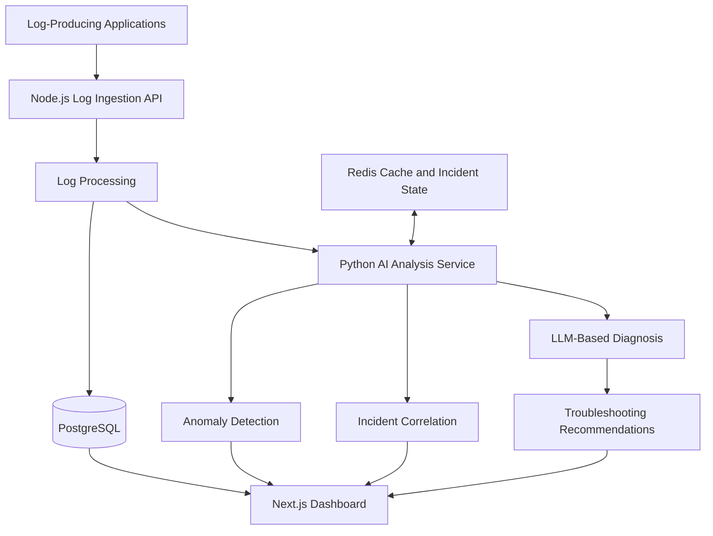

# LogSense AI

**Intelligent Log Monitoring & Incident Diagnosis Platform**

LogSense AI is an AI-powered log monitoring and incident diagnosis platform designed to help developers identify application issues, detect unusual behaviour, correlate related errors, and understand incidents through AI-assisted analysis.

The project explores how traditional log monitoring can be enhanced with machine learning, anomaly detection, and Large Language Models (LLMs) to provide more meaningful insights and actionable troubleshooting recommendations.

## Project Overview

Modern applications generate large volumes of logs across multiple services and environments. Identifying the root cause of an issue can be time-consuming, particularly when errors occur across interconnected services.

LogSense AI aims to address this challenge by providing a centralized platform that collects application logs, detects unusual patterns, identifies related incidents, and generates AI-assisted explanations.

The platform is being developed incrementally, starting with a functional log ingestion and storage backend before introducing AI-powered analysis and visualization.

## Objectives

- Centralize application log collection and processing.
- Detect anomalies and unusual application behaviour.
- Identify and group related errors into incidents.
- Apply machine learning techniques to log analysis.
- Use LLMs to explain detected incidents and their potential causes.
- Generate actionable troubleshooting recommendations.
- Provide a dashboard for monitoring logs, anomalies, and incidents.
- Automate testing, containerization, deployment, and infrastructure management.

## Proposed Solution

The proposed platform follows a modular architecture consisting of several interconnected components.

1. **Log-producing applications:** Generate structured application logs containing timestamps, severity levels, service information, events, and error details.
2. **Log ingestion backend:** Receives, validates, processes, and stores incoming logs.
3. **AI analysis service:** Performs anomaly detection, error classification, incident correlation, and AI-assisted diagnosis.
4. **Data storage and caching:** PostgreSQL stores persistent log records, while Redis supports caching and incident state management.
5. **LLM integration:** Uses local and external language models to explain incidents and generate troubleshooting recommendations.
6. **Frontend dashboard:** Presents logs, detected anomalies, incidents, and AI-generated diagnostic information.
7. **DevOps infrastructure:** Supports automated testing, containerization, deployment, orchestration, and monitoring.

The platform will use a hybrid approach to incident analysis. Statistical and machine learning techniques will identify unusual behaviour, while LLMs will assist with interpreting incidents and explaining possible causes.

## System Architecture

The following diagram illustrates the planned high-level architecture.



*Note: This represents the target architecture. Components are being implemented incrementally.*

## Technology Stack

| Area | Technology |
|---|---|
| Frontend | Next.js, TypeScript |
| Backend API | Node.js, Express |
| AI Service | Python, FastAPI |
| AI Models | Ollama, External LLM APIs |
| Machine Learning | Python |
| Primary Database | PostgreSQL |
| Caching and Incident State | Redis |
| Containerization | Docker, Docker Compose |
| Orchestration | Kubernetes |
| Infrastructure as Code | Terraform |
| CI/CD | Jenkins |
| Monitoring and Observability | Prometheus, Grafana |
| Version Control | Git, GitHub |
| Cloud Platform | AWS |

## Project Structure

```text
LogSense-AI/
├── frontend/              # Next.js dashboard
├── backend/               # Node.js API and log ingestion
│   ├── src/
│   │   ├── config/        # Application configuration
│   │   ├── database/      # Database schema
│   │   ├── middleware/    # Express middleware
│   │   ├── routes/        # API routes
│   │   ├── services/      # Business logic and database operations
│   │   ├── utils/         # Validation and response utilities
│   │   ├── app.js         # Express application
│   │   └── server.js      # HTTP server
│   ├── tests/             # Backend unit and integration tests
│   ├── Dockerfile
│   └── package.json
├── ai-service/            # Python AI and diagnosis service
├── sample-app/            # Sample application for generating logs
├── infrastructure/        # Infrastructure as Code
├── tests/                 # Project-level tests
├── docs/                  # Technical documentation
│   └── DEVELOPMENT.md
├── docker-compose.yml
├── .dockerignore
├── .env.example
├── .gitignore
└── README.md
```

## Development Progress

The project is being implemented incrementally.

| Component | Current status |
|---|---|
| Project structure and repository setup | Completed |
| Sample log-producing application | Implemented |
| Node.js log ingestion API | Implemented |
| PostgreSQL integration | Implemented |
| Log validation and batch ingestion | Implemented |
| Log retrieval, filtering and pagination | Implemented |
| Log statistics endpoint | Implemented |
| API error handling | Implemented |
| Automated backend tests | 38 tests passing |
| Dockerized PostgreSQL and backend | Implemented |
| Sample application containerization | Planned |
| Python AI service | Planned |
| Anomaly detection and incident correlation | Planned |
| LLM-based incident diagnosis | Planned |
| Redis integration | Planned |
| Frontend dashboard | Planned |
| Kubernetes deployment | Planned |
| CI/CD automation | Planned |
| Terraform and AWS deployment | Planned |
| Prometheus and Grafana monitoring | Planned |

## Development Approach

Development begins locally using Docker and Docker Compose. Each component is implemented and tested independently before being integrated into the overall platform.

The initial focus is on establishing reliable log collection, validation, storage, and retrieval. AI-powered analysis will be introduced after the core log ingestion pipeline is established.

The longer-term objective is to develop a containerized, observable, and scalable platform with automated deployment and cloud infrastructure.

## Documentation

- [Development Guide](docs/DEVELOPMENT.md) – Project setup, environment configuration, Docker commands, backend development, database management, testing, and troubleshooting.

## Project Goals

LogSense AI aims to demonstrate practical skills and experience in:

- AI engineering and LLM integration
- Machine learning and anomaly detection
- Backend and REST API development
- Log processing and incident analysis
- Microservices architecture
- PostgreSQL and Redis
- Docker and Kubernetes
- Automated testing and CI/CD
- Infrastructure as Code
- Cloud computing and observability

---

**Project:** LogSense AI
**Repository:** [GitHub](https://github.com/ayeshanweerasuriya/LogSense-AI)